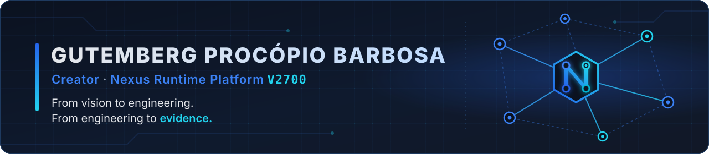
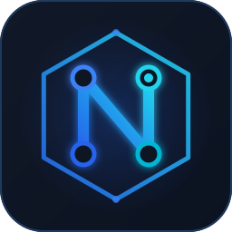

  

<h1 align="center">Gutemberg Procópio Barbosa</h1>

  Creator and maintainer of the <strong>Nexus Runtime Platform</strong> — an experimental, evidence-first distributed runtime.

  <a href="https://github.com/gutembergpb27/Termux-nexus">Nexus on GitHub</a>
  &nbsp;·&nbsp;
  <a href="https://www.linkedin.com/in/gutemberg-procopio-barbosa-2ab691410">LinkedIn</a>
  &nbsp;·&nbsp;
  <a href="#português-brasil">Português (Brasil)</a>

---

## Creator

I create and maintain the **[Nexus Runtime Platform](https://github.com/gutembergpb27/Termux-nexus)**, a Python distributed runtime that I build and validate on Windows and Android/Termux devices.

My working method:

- **Evidence first.** A capability counts only when tests, logs or reproducible runs back it.
- **Explicit limitations.** I document what is missing and what is still experimental next to what works.
- **Audit before claims.** I review safety properties before describing them, and I correct earlier wording when an audit shows it was too strong.
- **Small, reversible changes.** Work lands through pull requests; since November 2026, changes to `main` also require three CI checks.

## Professional background

- **Nexus Runtime Platform** — creator and maintainer since 2026-07-01. As of 2026-11-04: 436 commits and 101 merged pull requests on `main`.

## Technical competencies

Only areas demonstrated in the Nexus repository are listed. Each one links to the evidence on `main`.

| Group | Area | Evidence |
|---|---|---|
| Distributed systems | Physical multi-device validation (Windows + Android/Termux) | [docs/windows_android_validation.md](https://github.com/gutembergpb27/Termux-nexus/blob/main/docs/windows_android_validation.md) |
| Security | HMAC-SHA256 message envelopes with TTL and replay protection | [nexus_protocol.py](https://github.com/gutembergpb27/Termux-nexus/blob/main/nexus_protocol.py) |
| Security | Documented security boundaries | [Security trust boundary](https://github.com/gutembergpb27/Termux-nexus/blob/main/docs/NEXUS_V2700_SECURITY_TRUST_BOUNDARY.md) |
| Persistence & integrity | Hash-chained append log with integrity checks | [persistence.py](https://github.com/gutembergpb27/Termux-nexus/blob/main/persistence.py), [tests/test_integrity.py](https://github.com/gutembergpb27/Termux-nexus/blob/main/tests/test_integrity.py) |
| Validation & resilience | Fault-injection and statistical resilience campaigns | [Resilience case study](https://github.com/gutembergpb27/Termux-nexus/blob/main/docs/NEXUS_V2700_RESILIENCE_CASE_STUDY.md), [Axis 11 report](https://github.com/gutembergpb27/Termux-nexus/blob/main/docs/validation/NEXUS-V2700-AXIS-11-STATISTICAL-RESILIENCE.md) |
| Validation & resilience | Experimental validation harnesses (S1–S5 scenarios, hub hardening) | [validation/](https://github.com/gutembergpb27/Termux-nexus/tree/main/validation) |
| Tooling & CI | CI and branch governance (pull requests and required checks) | [.github/workflows/ci.yml](https://github.com/gutembergpb27/Termux-nexus/blob/main/.github/workflows/ci.yml) |
| Tooling & CI | CLI and runtime observability (health, readiness, metrics) | [nexus/cli.py](https://github.com/gutembergpb27/Termux-nexus/blob/main/nexus/cli.py), [nexus/runtime/metrics.py](https://github.com/gutembergpb27/Termux-nexus/blob/main/nexus/runtime/metrics.py) |
| Tooling & CI | Technical documentation and reproduction guides | [docs/](https://github.com/gutembergpb27/Termux-nexus/tree/main/docs) |

## Nexus Runtime Platform

- **Status:** experimental. The latest pre-release is `v2700.0.0-rc2`, and the latest stable GitHub release is `v2500.0.0`.
- **Recent work:** a read-only [consensus-safety audit](https://github.com/gutembergpb27/Termux-nexus/blob/main/docs/NEXUS_V2700_W08A_CONSENSUS_SAFETY_AUDIT.md) (merged, #103) and an explicit fail-closed cluster mode (`NEXUS_CLUSTER_MODE`) merged in [#104](https://github.com/gutembergpb27/Termux-nexus/pull/104): nodes now fail closed unless the cluster mode is set explicitly.
- **Not claimed:** distributed consensus, partition safety or production readiness. Nexus has no persistent election term/vote, no leader fencing and no majority commit. Distributed writes are blocked in every cluster mode and stay blocked until those invariants are demonstrated.
- **Known limitations** are documented in [docs/canonical/LIMITATIONS.md](https://github.com/gutembergpb27/Termux-nexus/blob/main/docs/canonical/LIMITATIONS.md) and [docs/PROJECT_STATE.md](https://github.com/gutembergpb27/Termux-nexus/blob/main/docs/PROJECT_STATE.md).

## Development evidence

### Selected timeline

| Date | Milestone |
|---|---|
| 2026-07-07 | `v1900`: earliest tag in the repository |
| 2026-07-29 | `v2500.0.0`: current stable GitHub release |
| 2026-08-28 | `v2700.0.0-rc1`: first V2700 release candidate |
| 2026-09-02 | `nirt-02-audited-integration`: audited experimental integration provenance tag |
| 2026-09-17 | `v2700.0.0-rc2`: current pre-release |

Work after RC2 (validation harnesses, experimental hub hardening, an authenticated MASTER liveness probe) is on `main` but not tagged yet.

### CI governance

Since November 2026, changes to `main` require a pull request and three CI checks ([workflow](https://github.com/gutembergpb27/Termux-nexus/blob/main/.github/workflows/ci.yml)). As of 2026-11-04: 101 merged pull requests and 436 commits on `main` since 2026-07-01.

### Documentation

Architecture, validation reports, limitations and reproduction guides are in [docs/](https://github.com/gutembergpb27/Termux-nexus/tree/main/docs).

### Tech

Verified in the Nexus repository:

- **Languages:** Python, PowerShell, Shell
- **Testing and CI:** pytest, GitHub Actions
- **Storage and integrity:** SQLite, SHA-256 hash chains
- **Security primitives:** HMAC-SHA256 with timing-safe comparison
- **Platforms validated:** Windows, Android/Termux

---

## Português (Brasil)

### Criador

Sou o criador e mantenedor da **[Nexus Runtime Platform](https://github.com/gutembergpb27/Termux-nexus)**, um runtime distribuído em Python que desenvolvo e valido em dispositivos Windows e Android/Termux.

Meu método de trabalho:

- **Evidência antes de afirmação.** Uma capacidade só conta quando testes, logs ou execuções reproduzíveis a sustentam.
- **Limitações explícitas.** Documento o que falta e o que ainda é experimental ao lado do que funciona.
- **Auditoria antes de alegações.** Reviso propriedades de segurança antes de descrevê-las e corrijo textos anteriores quando uma auditoria mostra que eram fortes demais.
- **Mudanças pequenas e reversíveis.** O trabalho entra por pull requests com três verificações de CI obrigatórias.

### Trajetória profissional

- **Nexus Runtime Platform** — criador e mantenedor desde 2026-07-01. Em 2026-11-04: 436 commits e 101 pull requests mesclados na `main`.

### Competências técnicas

Somente áreas demonstradas no repositório Nexus. As evidências estão na tabela [Technical competencies](#technical-competencies) acima.

- **Sistemas distribuídos:** validação física em múltiplos dispositivos (Windows + Android/Termux).
- **Segurança:** envelopes de mensagem HMAC-SHA256 com TTL e proteção contra replay; fronteiras de segurança documentadas.
- **Persistência e integridade:** log encadeado por hash com verificações de integridade.
- **Validação e resiliência:** campanhas de injeção de falhas e de resiliência estatística; harnesses experimentais de validação (cenários S1–S5, endurecimento do hub).
- **Ferramentas e CI:** governança de CI e de branch (pull requests e verificações obrigatórias); CLI e observabilidade do runtime (health, readiness, métricas); documentação técnica e guias de reprodução.

### Nexus Runtime Platform

- **Status:** experimental. A pré-release mais recente é a `v2700.0.0-rc2`, e a release estável mais recente no GitHub é a `v2500.0.0`.
- **Trabalho recente:** uma [auditoria de segurança de consenso](https://github.com/gutembergpb27/Termux-nexus/blob/main/docs/NEXUS_V2700_W08A_CONSENSUS_SAFETY_AUDIT.md) somente leitura (integrada, #103) e um modo de cluster *fail-closed* explícito (`NEXUS_CLUSTER_MODE`) integrado na [#104](https://github.com/gutembergpb27/Termux-nexus/pull/104): os nós agora falham de forma segura, a menos que o modo de cluster seja definido explicitamente.
- **Não declarado:** consenso distribuído, segurança sob partição de rede ou prontidão para produção. O Nexus não tem termo/voto de eleição persistente, *fencing* de líder nem commit por maioria. Escritas distribuídas são bloqueadas em todos os modos de cluster e permanecem bloqueadas até que essas invariantes sejam demonstradas.
- **Limitações conhecidas** estão documentadas em [docs/canonical/LIMITATIONS.md](https://github.com/gutembergpb27/Termux-nexus/blob/main/docs/canonical/LIMITATIONS.md) e [docs/PROJECT_STATE.md](https://github.com/gutembergpb27/Termux-nexus/blob/main/docs/PROJECT_STATE.md).

### Evidências de desenvolvimento

| Data | Marco |
|---|---|
| 2026-07-07 | `v1900`: tag mais antiga do repositório |
| 2026-07-29 | `v2500.0.0`: release estável atual no GitHub |
| 2026-08-28 | `v2700.0.0-rc1`: primeiro release candidate da V2700 |
| 2026-09-02 | `nirt-02-audited-integration`: tag de proveniência da integração experimental auditada |
| 2026-09-17 | `v2700.0.0-rc2`: pré-release atual |

O trabalho posterior à RC2 (harnesses de validação, endurecimento experimental do hub, uma sonda autenticada de vivacidade do MASTER) está na `main`, mas ainda não tem tag.

- **Governança de CI:** desde novembro de 2026, mudanças na `main` exigem um pull request e três verificações de CI ([workflow](https://github.com/gutembergpb27/Termux-nexus/blob/main/.github/workflows/ci.yml)). Em 2026-11-04: 101 pull requests mesclados e 436 commits na `main` desde 2026-07-01.
- **Documentação:** arquitetura, relatórios de validação, limitações e guias de reprodução estão em [docs/](https://github.com/gutembergpb27/Termux-nexus/tree/main/docs).
- **Tecnologias (verificado no repositório Nexus):** Python, PowerShell, Shell · pytest, GitHub Actions · SQLite, cadeias de hash SHA-256 · HMAC-SHA256 com comparação em tempo constante · Windows, Android/Termux.

---

  

  <em>From vision to engineering. From engineering to evidence.</em> 
  <em>Da visão à engenharia. Da engenharia à evidência.</em>

